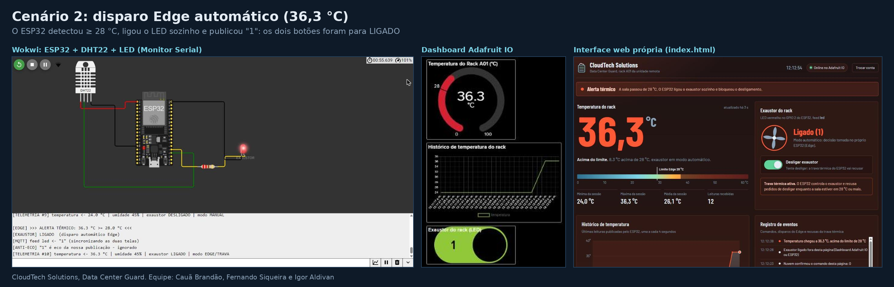

# CloudTech Data Center Guard

Monitoramento e controle inteligente de um rack de servidores remoto com **ESP32 (Wokwi)**, **Edge Computing**, **Adafruit IO** e uma **interface web própria** sincronizada em tempo real.

Projeto Final de **Cloud Computing e Internet das Coisas**, Senac, Tecnologia em Sistemas para Internet (2026.2).

| Integrante | GitHub |
|---|---|
| Cauã Brandão | [@CauaBrandao](https://github.com/CauaBrandao) |
| Fernando Siqueira | [@Fesiqqq](https://github.com/Fesiqqq) |
| Igor Aldivan | [@IgorAldivanSL](https://github.com/IgorAldivanSL) |

**Links:** [Simulação no Wokwi](https://wokwi.com/projects/481038800719294465) · [Dashboard público no Adafruit IO](https://io.adafruit.com/cauaaaaaaaaaaaa/dashboards/cloudtech-rack-a01) · [Apresentação (PDF)](docs/Apresentacao_CloudTech.pdf)



## O problema

A CloudTech Solutions mantém um rack de servidores numa unidade sem equipe presencial 24 horas. O ar-condicionado falhou, a temperatura subiu sem ninguém perceber e o servidor principal desligou por superaquecimento, causando **4 horas de downtime**.

## A solução

```
ESP32 no Wokwi  ── MQTT :1883 ──▶  Adafruit IO  ◀── WebSocket wss :443 ──  index.html
(DHT22 + LED)   ◀── feed "led" ──  (feeds temperatura e led)                   + Dashboard nativo
```

- **Hardware (Wokwi):** ESP32 com DHT22 no GPIO 15 e LED vermelho (exaustor) com resistor de 220 Ω no GPIO 2.
- **Nuvem (Adafruit IO):** feeds `temperatura` e `led` e um dashboard com Gauge, Line Chart e Toggle (1/0).
- **Interface web (`web/index.html`):** painel próprio via MQTT sobre WebSocket, com consulta `/get` ao abrir, alerta visual a partir de 28 °C, gráfico e registro de eventos.

## Regras de funcionamento

| Situação | O que acontece |
|---|---|
| Abaixo de 28 °C | Controle manual livre: o Toggle do Adafruit IO ou o botão da página liga/desliga o LED em até 1 s, e a outra tela acompanha. |
| Chegou a 28 °C | **Disparo Edge:** o próprio ESP32 liga o LED e publica `1`, e os dois botões vão para LIGADO. |
| Pediram `0` com calor | **Trava térmica:** o ESP32 recusa, mantém o LED aceso e publica `1` de volta (o botão "pula de volta"). |
| Voltou abaixo de 28 °C | **Retorno automático:** o ESP32 apaga o LED e publica `0`. |

Detalhes do firmware (`wokwi/sketch.ino`):

- O laço `for` de 4 voltas lê o sensor a cada 1 s e escuta comandos com `mqtt.readSubscription(1000)`, sem `delay()`. Ao fim das 4 voltas, publica a temperatura: 60 s ÷ 4 s = **15 pontos/min**, metade da cota gratuita.
- `led_sub` e `led_pub` no mesmo feed: o ESP32 ouve cliques e também move os botões.
- O **filtro anti-eco** (`ignorarEco`, `valorEco`, `instanteEco`) descarta a própria publicação devolvida pelo broker.
- O Edge continua protegendo o rack **mesmo sem internet**. Ao reconectar, o ESP32 republica o estado real do LED.

## Como rodar

1. **Adafruit IO:** crie os feeds `temperatura` e `led` e um dashboard com Gauge (0 a 100), Line Chart e Toggle (On = `1`, Off = `0`).
2. **Wokwi:** abra o [projeto](https://wokwi.com/projects/481038800719294465) (ou crie um com os arquivos da pasta `wokwi/`). Troque `SEU_USUARIO_AQUI` e `SUA_CHAVE_AQUI` pelos seus dados **só localmente**, sem salvar, e clique em ▶.
3. **Web:** abra `web/index.html` no navegador e informe usuário e chave na janela "Conectar". A chave fica apenas no seu navegador.

> Nunca publique a sua AIO Key. Os arquivos deste repositório usam `SUA_CHAVE_AQUI`.

## Prints

| Cenário | Imagem |
|---|---|
| Controle manual no frio | [01_frio_manual.png](prints/01_frio_manual.png) |
| Disparo Edge (36,3 °C) | [02_disparo_edge.png](prints/02_disparo_edge.png) |
| Trava térmica | [03_trava_termica.png](prints/03_trava_termica.png) |
| Retorno automático (21,4 °C) | [04_retorno_automatico.png](prints/04_retorno_automatico.png) |

## Estrutura

```
wokwi/   sketch.ino, diagram.json, libraries.txt
web/     index.html
prints/  capturas das 3 telas operando juntas
docs/    apresentação em PDF
```
